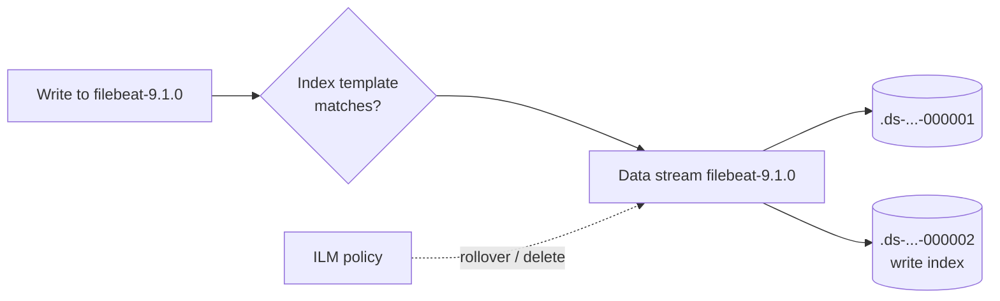

#ELASTIC #ElasticSearch 

# ElasticSearch - Index Management

How ElasticSearch decides the settings, mappings and lifecycle of time series data (logs, metrics). The three pieces work together: **index templates** define how the data is stored, **data streams** organise it in time-based backing indices and **ILM** rolls them over and deletes them. See [[ElasticSearch]] for the general concepts.



## Index templates

An index template is applied **when an index or data stream is created** if its name matches `index_patterns`. Changing a template doesn't affect existing indices: it applies on the next rollover.

Templates are built from reusable **component templates**:

```json
PUT _component_template/myapp-mappings
{
  "template": {
    "mappings": {
      "properties": {
        "@timestamp": { "type": "date" },
        "service":    { "type": "keyword" },
        "log.level":  { "type": "keyword" },
        "message":    { "type": "match_only_text" }
      }
    }
  }
}

PUT _component_template/myapp-settings
{
  "template": {
    "settings": {
      "number_of_shards": 1,
      "number_of_replicas": 1,
      "index.lifecycle.name": "myapp-ilm",
      "index.default_pipeline": "myapp-pipeline"
    }
  }
}

PUT _index_template/myapp
{
  "index_patterns": ["myapp-*"],
  "data_stream": {},
  "composed_of": ["myapp-mappings", "myapp-settings"],
  "priority": 200
}
```

| Field             | Description                                                                        |
| ----------------- | ---------------------------------------------------------------------------------- |
| `index_patterns`  | Names that use this template                                                       |
| `data_stream: {}` | Matching names are created as data streams instead of normal indices               |
| `composed_of`     | Component templates, merged in order (later ones override)                         |
| `priority`        | If several templates match, the highest priority wins (only one is applied)        |
| `template`        | Settings / mappings / aliases defined directly (override the components)          |

> [!warning] Built-in templates use patterns like `logs-*-*` and `metrics-*-*` with priority `100`. Use a **priority above 100** for your templates or a pattern that doesn't overlap.

```json
GET _index_template/myapp
POST _index_template/_simulate_index/myapp-test    // Final settings/mappings that a new index would get
```

`filebeat setup --index-management` loads the template `filebeat-<version>` for the data stream `filebeat-<version>` (see [[FileBeat - Configuration for ElasticSearch]]).

## Data streams

A data stream is the recommended way to store append-only time series data.

- Every document **must** have a `@timestamp` field.
- Writes are **only creates** (`op_type: create`). To update or delete documents use `_update_by_query` / `_delete_by_query`.
- Data is stored in hidden backing indices: `.ds-<data-stream>-<yyyy.MM.dd>-<generation>`. Only the newest one (**write index**) receives new documents.
- Searches on the data stream name query all backing indices.

```json
GET _data_stream/filebeat-*
GET _data_stream/filebeat-9.1.0/_stats
POST filebeat-9.1.0/_rollover            // Force a new backing index (e.g. after changing the template)
DELETE _data_stream/myapp-test           // Deletes the data stream AND its data
```

> [!tip] Naming convention for Elastic Agent and the built-in templates: `<type>-<dataset>-<namespace>`, e.g. `logs-nginx.access-production`. It allows different retention per dataset or namespace.

## ILM: Index Lifecycle Management

An ILM policy defines the **phases** of the data and the **actions** in each one:

| Phase    | Typical actions                                               |
| -------- | ------------------------------------------------------------- |
| `hot`    | Being written and queried. `rollover`                         |
| `warm`   | Not written, still queried. `shrink`, `forcemerge`, move to warm nodes |
| `cold`   | Rarely queried. Fewer replicas, searchable snapshots (paid)   |
| `frozen` | Very rarely queried, searchable snapshots (paid)              |
| `delete` | `delete` the index                                            |

```json
PUT _ilm/policy/myapp-ilm
{
  "policy": {
    "phases": {
      "hot": {
        "actions": {
          "rollover": {
            "max_primary_shard_size": "50gb",
            "max_age": "1d"
          }
        }
      },
      "warm": {
        "min_age": "7d",
        "actions": {
          "forcemerge": { "max_num_segments": 1 }
        }
      },
      "delete": {
        "min_age": "30d",
        "actions": { "delete": {} }
      }
    }
  }
}
```

> [!important] `min_age` is counted **from the rollover**, not from the creation of the index. With `max_age: 1d` and delete `min_age: 30d`, data is kept ~31 days.

The policy is linked to the indices with the setting `index.lifecycle.name` (in the index template). Check the status:

```json
GET _ilm/policy/myapp-ilm
GET filebeat-*/_ilm/explain             // Phase, action and errors of each backing index
POST <index>/_ilm/retry                 // Retry after fixing an ILM error
```

> [!note] Data streams also support a simpler **data stream lifecycle** (`"lifecycle": { "data_retention": "30d" }` in the template), managed by ElasticSearch without phases. ILM takes precedence if both are configured.

To change the retention of FileBeat data, edit the `filebeat` ILM policy (Kibana → Stack Management → Index Lifecycle Policies) or set `setup.ilm.policy_name` / `setup.ilm.policy_file` in `filebeat.yml`.

## Reindex and aliases

```json
POST _reindex
{
  "source": { "index": "old-index" },
  "dest":   { "index": "new-index", "pipeline": "myapp-pipeline" }
}

POST _aliases
{
  "actions": [
    { "add": { "index": "new-index", "alias": "myapp" } },
    { "remove": { "index": "old-index", "alias": "myapp" } }
  ]
}
```

`_reindex` can run an [[ElasticSearch - Ingest Pipelines|ingest pipeline]] on the documents, useful to re-parse old data after fixing a pipeline.

## Troubleshooting

| Problem                                            | Check                                                                     |
| -------------------------------------------------- | ------------------------------------------------------------------------- |
| New index doesn't get my mapping                   | Template pattern / priority. `POST _index_template/_simulate_index/<name>` |
| Template changed but nothing changes               | Templates apply on creation → `POST <data-stream>/_rollover`              |
| `only write ops with an op_type of create are allowed in data streams` | Client sends `index` instead of `create` (LogStash: `action => "create"`) |
| Indices never deleted / huge                       | `GET <index>/_ilm/explain`: policy not attached or ILM error               |
| Too many shards                                    | Rollover by size (`max_primary_shard_size`) instead of only by age        |

## Related notes

- [[ElasticSearch]]
- [[ElasticSearch - Ingest Pipelines]]
- [[FileBeat - Configuration for ElasticSearch]]
