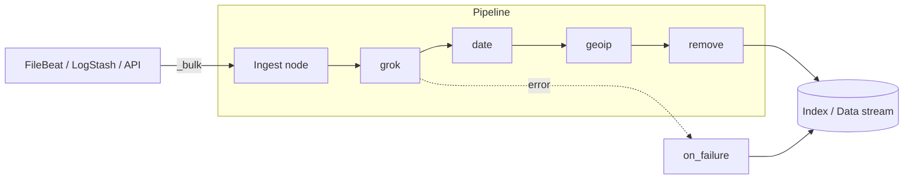

#ELASTIC #ElasticSearch 

# ElasticSearch - Ingest Pipelines

An **ingest pipeline** is a list of **processors** that ElasticSearch runs on every document **before indexing it**: parse a log line, rename fields, convert types, add GeoIP data, drop events... It's a lightweight alternative to LogStash for the transformations that don't need several outputs or complex logic. See [[ElasticSearch]] for the general concepts.



- Pipelines run in nodes with the **`ingest`** role (all nodes have it by default).
- They are stored in the **cluster state**, so they are available in every node.
- They are managed with the `_ingest/pipeline` API or in **Kibana → Stack Management → Ingest Pipelines**.

## Where the parsing should be done

| Place                          | Good for                                                                 | Limits                                           |
| ------------------------------ | ------------------------------------------------------------------------ | ------------------------------------------------ |
| FileBeat processors / parsers  | Multiline, JSON decode, add / drop fields on the host                    | Simple logic, consumes host CPU                  |
| **Ingest pipelines**           | Grok / dissect, dates, GeoIP, user agent, ECS mapping. Used by FileBeat **modules** | Only one destination (ElasticSearch), no buffering |
| [[LogStash - Pipeline Configuration\|LogStash filters]] | Heavy enrichment, several outputs, persistent queues                     | Extra component to deploy and operate            |

## Create a pipeline

```json
PUT _ingest/pipeline/myapp-pipeline
{
  "description": "Parse myapp logs",
  "processors": [
    {
      "grok": {
        "field": "message",
        "patterns": ["%{TIMESTAMP_ISO8601:log_ts} %{LOGLEVEL:log.level} \\[%{DATA:process.thread.name}\\] %{GREEDYDATA:event.original_msg}"]
      }
    },
    {
      "date": {
        "field": "log_ts",
        "formats": ["ISO8601", "yyyy-MM-dd HH:mm:ss,SSS"],
        "target_field": "@timestamp",
        "timezone": "Europe/Madrid"
      }
    },
    { "lowercase": { "field": "log.level" } },
    { "remove": { "field": ["log_ts"], "ignore_missing": true } }
  ],
  "on_failure": [
    { "set": { "field": "event.kind", "value": "pipeline_error" } },
    { "set": { "field": "error.message", "value": "{{ _ingest.on_failure_message }}" } }
  ]
}
```

Other operations:

```json
GET _ingest/pipeline                    // All pipelines
GET _ingest/pipeline/myapp-pipeline
GET _ingest/pipeline/filebeat-*         // Pipelines loaded by FileBeat modules
DELETE _ingest/pipeline/myapp-pipeline
GET _nodes/stats/ingest                 // Count, time and failures per pipeline and processor
```

> [!important] `PUT` replaces the whole pipeline. To change it, send the complete definition again (you can add a `"version": 2` field to keep track).

## Test it: `_simulate`

Always test a pipeline before using it. `verbose=true` shows the result after each processor:

```json
POST _ingest/pipeline/myapp-pipeline/_simulate?verbose=true
{
  "docs": [
    { "_source": { "message": "2026-10-19 10:00:00,123 ERROR [main] Connection refused" } },
    { "_source": { "message": "this line doesn't match" } }
  ]
}
```

You can also simulate a pipeline that doesn't exist yet with `POST _ingest/pipeline/_simulate` and the definition under `"pipeline": { ... }`.

> [!tip] Use **Kibana → Dev Tools → Grok Debugger** to build grok patterns, and `GET _ingest/processor/grok` to list the built-in patterns.

## Common processors

| Processor        | Use                                                                               |
| ---------------- | --------------------------------------------------------------------------------- |
| `grok`           | Parse unstructured text with regex-based patterns (`%{IP:source.ip}`)             |
| `dissect`        | Split text by delimiters. Faster than grok when the format is fixed               |
| `json`           | Parse a JSON string into fields                                                   |
| `kv`             | Parse `key=value` pairs                                                           |
| `date`           | Parse a date string into `@timestamp`                                             |
| `set` / `append` | Set a value (supports `{{ mustache }}` templates) / add to an array               |
| `rename` / `remove` | Rename or delete fields                                                        |
| `convert`        | Change type: `integer`, `long`, `float`, `boolean`, `ip`, `string`...             |
| `lowercase` / `uppercase` / `trim` / `split` / `gsub` | String operations                              |
| `geoip`          | Add location from an IP (`source.ip` → `source.geo.*`)                            |
| `user_agent`     | Parse the user agent string (browser, OS, device)                                 |
| `uri_parts`      | Split a URL into `url.domain`, `url.path`, `url.query`...                         |
| `fingerprint`    | Hash of some fields, useful to generate an `_id` and avoid duplicates             |
| `enrich`         | Add data from another index (lookup, e.g. IP → owner team)                        |
| `script`         | Custom logic in **Painless**                                                      |
| `drop`           | Discard the document (not indexed)                                                |
| `fail`           | Raise a custom error                                                              |
| `pipeline`       | Call another pipeline (reuse common steps)                                        |
| `reroute`        | Send the document to another data stream (`dataset` / `namespace`)               |

### Conditions: `if`

Every processor accepts an `if` written in **Painless**. Use `?.` to avoid null pointer errors when a field doesn't exist:

```json
{
  "drop": {
    "if": "ctx.log?.level == 'debug'"
  }
},
{
  "pipeline": {
    "if": "ctx.service == 'nginx'",
    "name": "nginx-pipeline"
  }
}
```

`ctx` is the document. Fields with dots must be accessed as objects: `ctx.log.level`, or `ctx['log.level']` if the field name literally contains a dot.

### Common processor options

| Option           | Description                                                                 |
| ---------------- | --------------------------------------------------------------------------- |
| `if`             | Condition to run the processor                                              |
| `ignore_missing` | Don't fail if the source field doesn't exist                                |
| `ignore_failure` | Continue with the next processor if this one fails                          |
| `on_failure`     | Processors to run if this processor fails                                   |
| `tag`            | Identifier of the processor, shown in errors and stats                      |

## Error handling

When a processor fails and there is no `on_failure`, the **whole document is rejected** (FileBeat logs the error and drops or retries the event). Two levels of handling:

- **Processor level**: `on_failure` or `ignore_failure` in a single processor.
- **Pipeline level**: `on_failure` at the root, runs if any processor fails.

Inside `on_failure` these metadata fields are available: `_ingest.on_failure_message`, `_ingest.on_failure_processor_type`, `_ingest.on_failure_processor_tag`, `_ingest.on_failure_pipeline`.

A common pattern is to send the failed documents to a separate index to review them:

```json
"on_failure": [
  { "set": { "field": "error.message", "value": "{{ _ingest.on_failure_message }}" } },
  { "set": { "field": "_index", "value": "failed-{{ _index }}" } }
]
```

> [!warning] If the target is a **data stream**, `failed-...` must also match an index template with `data_stream` enabled, or use a normal index name that doesn't match any data stream template.

## How to apply a pipeline

| Method                                  | Example                                                                  |
| --------------------------------------- | ------------------------------------------------------------------------ |
| In the request                          | `POST my-index/_doc?pipeline=myapp-pipeline`, `POST _bulk?pipeline=...`  |
| From FileBeat                           | `output.elasticsearch.pipeline` / `pipelines:` with conditions           |
| From LogStash                           | `pipeline => "myapp-pipeline"` in the `elasticsearch` output             |
| `index.default_pipeline` (index setting) | Runs if the request doesn't specify another pipeline                    |
| `index.final_pipeline` (index setting)  | **Always** runs at the end, after the request / default pipeline         |

The settings are normally defined in the **index template** (see [[ElasticSearch - Index Management]]):

```json
PUT _index_template/myapp
{
  "index_patterns": ["myapp-*"],
  "data_stream": {},
  "priority": 200,
  "template": {
    "settings": {
      "index.default_pipeline": "myapp-pipeline"
    }
  }
}
```

## Ingest pipelines and FileBeat

FileBeat **modules** don't parse the logs in the host: each fileset has its own ingest pipeline that converts the raw line into **ECS** fields. They are loaded with `filebeat setup --pipelines` and are named:

```
filebeat-<version>-<module>-<fileset>-pipeline
e.g. filebeat-9.1.0-nginx-access-pipeline
```

FileBeat adds the pipeline name to each event, so ElasticSearch knows which one to run. That's why modules only work completely with `output.elasticsearch` or through LogStash forwarding `[@metadata][pipeline]`. Full setup in:

- [[FileBeat - Configuration for ElasticSearch]] (direct output, `filebeat setup`, `pipeline` option)
- [[FileBeat - Configuration for LogStash]] (section *Using FileBeat modules through LogStash*)

For your own logs (not covered by a module), send them to a custom pipeline:

```yaml
# filebeat.yml
output.elasticsearch:
  hosts: ["https://es01.example.com:9200"]
  pipelines:
    - pipeline: "myapp-pipeline"
      when.equals:
        service: "myapp"
    - pipeline: "nginx-custom-pipeline"
      when.contains:
        log.file.path: "/var/log/nginx"
```

> [!note] The `pipeline` option applies only to the events that don't come from a module. Module events always use their module pipeline.

> [!tip] The FileBeat user needs the `read_pipeline` cluster privilege to send events with a pipeline, and `manage_pipeline` to load them with `filebeat setup`.

### Elastic Agent integrations: `@custom` pipelines

With **Elastic Agent** (Fleet) integrations, the managed pipelines must not be edited (they are overwritten on upgrades). Instead, each integration calls an optional custom pipeline named `<type>-<dataset>@custom` (e.g. `logs-nginx.access@custom`). Create it and it will run automatically after the managed one.

## Enrich: lookups from another index

```json
// 1. Source index with the reference data
PUT hosts-owners/_doc/1
{ "host.name": "web01", "team": "frontend", "criticality": "high" }

// 2. Enrich policy
PUT _enrich/policy/host-owners-policy
{
  "match": {
    "indices": "hosts-owners",
    "match_field": "host.name",
    "enrich_fields": ["team", "criticality"]
  }
}

// 3. Build the enrich index (run again when the source data changes)
POST _enrich/policy/host-owners-policy/_execute

// 4. Use it in a pipeline
PUT _ingest/pipeline/add-owner
{
  "processors": [
    {
      "enrich": {
        "policy_name": "host-owners-policy",
        "field": "host.name",
        "target_field": "owner",
        "ignore_missing": true
      }
    }
  ]
}
```

## Full example: nginx access log

```json
PUT _ingest/pipeline/nginx-custom-pipeline
{
  "description": "nginx combined access log to ECS",
  "processors": [
    {
      "grok": {
        "field": "message",
        "patterns": ["%{IPORHOST:source.ip} - %{DATA:user.name} \\[%{HTTPDATE:nginx_ts}\\] \"%{WORD:http.request.method} %{DATA:url.original} HTTP/%{NUMBER:http.version}\" %{NUMBER:http.response.status_code:long} %{NUMBER:http.response.body.bytes:long} \"%{DATA:http.request.referrer}\" \"%{DATA:user_agent.original}\""]
      }
    },
    { "date":       { "field": "nginx_ts", "formats": ["dd/MMM/yyyy:HH:mm:ss Z"] } },
    { "geoip":      { "field": "source.ip", "target_field": "source.geo", "ignore_missing": true } },
    { "user_agent": { "field": "user_agent.original", "ignore_missing": true } },
    { "uri_parts":  { "field": "url.original", "ignore_failure": true } },
    { "remove":     { "field": ["nginx_ts"], "ignore_missing": true } }
  ],
  "on_failure": [
    { "set": { "field": "error.message", "value": "{{ _ingest.on_failure_message }}" } }
  ]
}
```

## Troubleshooting

| Problem                                          | Check                                                                         |
| ------------------------------------------------ | ----------------------------------------------------------------------------- |
| `pipeline with id [...] does not exist`          | Pipeline not created / FileBeat module pipelines not loaded (`filebeat setup --pipelines --modules <module>`) |
| Documents rejected, nothing indexed              | A processor fails without `on_failure`. Test with `_simulate?verbose=true`    |
| Grok doesn't match                               | Escape `\\[` `\\]` `\\"` inside JSON. Test in the Grok Debugger               |
| `@timestamp` wrong by some hours                 | Missing `timezone` in the `date` processor                                    |
| Field not converted / wrong type in the index    | The mapping wins: if the field already exists with another type, fix the index template and roll over |
| Slow indexing                                    | `GET _nodes/stats/ingest` → find the slowest processor (usually complex grok or `script`) |
| `security_exception` with `pipeline`             | Missing `read_pipeline` privilege in the client role                          |

## Related notes

- [[ElasticSearch]]
- [[ElasticSearch - Index Management]]
- [[FileBeat - Configuration for ElasticSearch]]
- [[FileBeat - Configuration for LogStash]]
- [[FileBeat - Configuration]]
- [[LogStash]]
