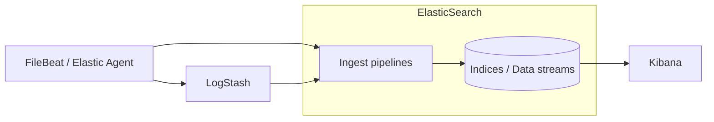
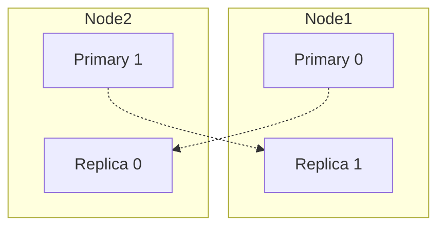

#ELASTIC  #ElasticSearch 

# ElasticSearch

ElasticSearch is a distributed **search and analytics engine** developed by **Elastic**, built on top of **Apache Lucene**. It stores data as **JSON documents**, indexes every field and exposes everything through a **REST API** (port `9200`).

It is the core of the **Elastic Stack** (formerly ELK):

| Component                        | Role                                                         |
| -------------------------------- | ------------------------------------------------------------ |
| **Beats** ([[FileBeat]], Metricbeat...) / Elastic Agent | Collect data on the hosts and ship it        |
| **[[LogStash]]**                 | Optional processing layer (heavy parsing, several outputs)   |
| **ElasticSearch**                | Stores, indexes, searches and aggregates the data            |
| **Kibana**                       | UI: Discover, dashboards, Dev Tools, stack management        |



Typical use cases: log and metrics centralisation (observability), full-text search in applications, security analytics (SIEM) and vector / semantic search.

> [!note] Licensing: since 2024 ElasticSearch and Kibana source code can be used under **AGPLv3**, **SSPL** or the **Elastic License 2.0**. The free features (basic license) cover security, ingest pipelines, ILM, Kibana dashboards... Some features (ML, searchable snapshots, cross-cluster replication...) require a paid subscription.

## Key concepts

| Concept           | Description                                                                                                         |
| ----------------- | ------------------------------------------------------------------------------------------------------------------- |
| **Document**      | Unit of data, a JSON object. Each document has a unique `_id` inside its index                                      |
| **Index**         | Collection of documents with a similar structure. Comparable to a table in a SQL database                          |
| **Mapping**       | Schema of an index: field names and types (`keyword`, `text`, `date`, `long`, `ip`, `geo_point`...)               |
| **Shard**         | Each index is split into shards (Lucene indices). This is how the data is distributed between nodes               |
| **Replica**       | Copy of a primary shard in **another** node. Gives high availability and more search capacity                      |
| **Node**          | One ElasticSearch process (JVM). Has one or more **roles**                                                         |
| **Cluster**       | Group of nodes sharing the same `cluster.name`. One of them is the elected master                                  |
| **Data stream**   | Append-only abstraction for time series data (logs, metrics). Writes go to hidden **backing indices** that roll over |
| **Index template** | Defines settings and mappings applied automatically to new indices / data streams matching a pattern              |
| **ILM**           | Index Lifecycle Management: rollover, move between tiers and delete old data automatically                         |
| **Ingest pipeline** | Chain of processors that transforms documents **before** they are indexed. See [[ElasticSearch - Ingest Pipelines]] |

### How it stores and searches

- Each `text` field is analysed (tokenized, lowercased...) and stored in an **inverted index**: a map from every term to the documents that contain it. That is why full-text searches are fast.
- `keyword` fields are not analysed: used for exact matches, sorting and aggregations (e.g. `host.name`, `http.response.status_code`).
- ElasticSearch is **near real-time**: a document is searchable after the next **refresh** (by default every `1s`).

> [!tip] With dynamic mapping, a string is mapped as `text` with a `.keyword` subfield. For logs it's better to define the mapping in an index template (or use **ECS** fields) to avoid wrong types and too many fields (*mapping explosion*).

### Shards and replicas



- `number_of_shards` is fixed when the index is created (it can only be changed with *split* / *shrink* / *reindex*). `number_of_replicas` can be changed at any time.
- A replica is never allocated in the same node as its primary, so a single node cluster with replicas will be **yellow**.
- Recommended shard size for logs: **10–50 GB**. Too many small shards waste memory in the master and data nodes.

### Cluster health

| Status    | Meaning                                                            |
| --------- | ------------------------------------------------------------------ |
| `green`   | All primary and replica shards allocated                           |
| `yellow`  | All primaries allocated, some replicas not (data available, no HA) |
| `red`     | At least one primary shard not allocated → some data unavailable   |

### Node roles

Configured with `node.roles` in `elasticsearch.yml`. If not set, the node has all roles.

| Role                    | Description                                                                 |
| ----------------------- | --------------------------------------------------------------------------- |
| `master`                | Eligible to be elected master (manages cluster state). Use **3** master-eligible nodes for HA |
| `data` / `data_hot` / `data_warm` / `data_cold` / `data_frozen` / `data_content` | Store shards. The tiers are used by ILM to move old data to cheaper hardware |
| `ingest`                | Runs **ingest pipelines**                                                   |
| `ml`, `transform`       | Machine learning jobs and transforms                                        |
| `remote_cluster_client` | Cross-cluster search / replication                                          |
| `[]` (empty)            | **Coordinating only** node: routes requests and merges results              |

## Installation

### RHEL / Rocky / Alma (RPM)

Use the same Elastic repository described in [[FileBeat]] (`/etc/yum.repos.d/elastic.repo`) and install:

```bash
sudo dnf install elasticsearch
```

On the first install, **security is auto-configured**: TLS certificates are generated and the password of the `elastic` superuser is printed in the terminal. Save it.

```bash
sudo systemctl daemon-reload
sudo systemctl enable --now elasticsearch

# Reset the elastic password if you lost it
sudo /usr/share/elasticsearch/bin/elasticsearch-reset-password -u elastic

# Enrollment token to connect Kibana (or a new node)
sudo /usr/share/elasticsearch/bin/elasticsearch-create-enrollment-token -s kibana

# Test
curl --cacert /etc/elasticsearch/certs/http_ca.crt -u elastic https://localhost:9200
```

Open the ports (`9200` HTTP/REST, `9300` transport between nodes):

```bash
sudo firewall-cmd --permanent --add-port={9200,9300}/tcp
sudo firewall-cmd --reload
```

### Docker (testing)

```bash
docker network create elastic
docker run -d --name es01 --net elastic -p 9200:9200 -m 2GB \
  -e "discovery.type=single-node" \
  docker.elastic.co/elasticsearch/elasticsearch:<version>

docker exec -it es01 /usr/share/elasticsearch/bin/elasticsearch-reset-password -u elastic
```

> [!warning] On the Docker host (and on any Linux host if it's not set) ElasticSearch needs `vm.max_map_count` ≥ `262144`:
> ```bash
> sudo sysctl -w vm.max_map_count=262144
> ```

### File locations (RPM / DEB)

| Path                                      | Content                                         |
| ----------------------------------------- | ----------------------------------------------- |
| `/etc/elasticsearch/elasticsearch.yml`    | Main configuration                              |
| `/etc/elasticsearch/jvm.options.d/`       | JVM options (heap size)                         |
| `/etc/elasticsearch/certs/`               | Auto-generated certificates (`http_ca.crt`)     |
| `/usr/share/elasticsearch/bin/`           | Tools (`elasticsearch-reset-password`, `elasticsearch-keystore`...) |
| `/var/lib/elasticsearch/`                 | Data (`path.data`)                              |
| `/var/log/elasticsearch/`                 | Logs (`<cluster.name>.log`)                     |

## Basic configuration

`/etc/elasticsearch/elasticsearch.yml` for a 3-node cluster:

```yaml
cluster.name: logs-prod
node.name: es01
node.roles: [master, data_hot, data_content, ingest]

path.data: /var/lib/elasticsearch
path.logs: /var/log/elasticsearch

network.host: 0.0.0.0
http.port: 9200

discovery.seed_hosts: ["es01.example.com", "es02.example.com", "es03.example.com"]
# Only the very first time the cluster is started:
cluster.initial_master_nodes: ["es01", "es02", "es03"]

xpack.security.enabled: true
xpack.security.http.ssl.enabled: true
xpack.security.transport.ssl.enabled: true
```

> [!important] Remove `cluster.initial_master_nodes` after the cluster has been formed. Leaving it can create a second cluster if nodes are restarted with an empty data folder.

JVM heap (`/etc/elasticsearch/jvm.options.d/heap.options`): by default it is calculated automatically. If you set it, use the same value for min and max, **≤ 50 % of the RAM** and below ~31 GB:

```
-Xms8g
-Xmx8g
```

## Working with the REST API

The easiest way is **Kibana → Dev Tools → Console**. With `curl` add `-u user` and `--cacert`.

### Cluster and indices

```json
GET /                                  // Version and cluster name
GET _cluster/health
GET _cat/nodes?v
GET _cat/indices?v&s=index
GET _cat/shards?v
GET _cluster/allocation/explain        // Why a shard is not allocated
```

### Documents (CRUD)

```json
PUT my-index
{
  "settings": { "number_of_shards": 1, "number_of_replicas": 1 },
  "mappings": {
    "properties": {
      "@timestamp": { "type": "date" },
      "service":    { "type": "keyword" },
      "message":    { "type": "text" }
    }
  }
}

POST my-index/_doc
{ "@timestamp": "2026-10-19T10:00:00Z", "service": "myapp", "message": "User logged in" }

GET my-index/_doc/<id>
DELETE my-index/_doc/<id>

POST _bulk
{ "index": { "_index": "my-index" } }
{ "@timestamp": "2026-10-19T10:00:01Z", "service": "myapp", "message": "Order created" }
```

> [!note] Beats and LogStash always write using the **`_bulk`** API, several documents per request.

### Search (Query DSL)

```json
GET my-index/_search
{
  "query": {
    "bool": {
      "must":   [ { "match": { "message": "logged" } } ],
      "filter": [
        { "term":  { "service": "myapp" } },
        { "range": { "@timestamp": { "gte": "now-1h" } } }
      ]
    }
  },
  "sort": [ { "@timestamp": "desc" } ],
  "size": 20
}
```

| Query    | Use                                                                   |
| -------- | --------------------------------------------------------------------- |
| `match`  | Full-text search on `text` fields (the input is analysed)             |
| `term`   | Exact value on `keyword`, numbers, dates...                           |
| `range`  | Numbers or dates between values                                       |
| `bool`   | Combine queries: `must`, `filter` (no scoring, cached), `should`, `must_not` |

### Aggregations

```json
GET filebeat-*/_search
{
  "size": 0,
  "aggs": {
    "per_host": { "terms": { "field": "host.name", "size": 10 } },
    "per_hour": { "date_histogram": { "field": "@timestamp", "calendar_interval": "1h" } }
  }
}
```

You can also query with **ES|QL** (Kibana Discover or `POST _query`):

```
FROM filebeat-*
| WHERE log.level == "error"
| STATS count = COUNT(*) BY host.name
| SORT count DESC
```

## Users and security

Security is enabled by default. Built-in users: `elastic` (superuser, use only for the setup), `kibana_system`, `logstash_system`, `beats_system`...

Create a **role** with the minimum privileges for each client and a user or an **API key** for it. Example for FileBeat in [[FileBeat - Configuration for ElasticSearch]].

```json
GET _security/_authenticate          // Who am I
GET _security/role/<role>
POST _security/api_key/_query        // List API keys
```

## Troubleshooting

| Problem                                         | Check                                                                                 |
| ----------------------------------------------- | ------------------------------------------------------------------------------------- |
| Doesn't start                                   | `journalctl -u elasticsearch`, `/var/log/elasticsearch/<cluster>.log`, bootstrap checks (`vm.max_map_count`, heap, file descriptors) |
| Cluster `yellow`                                | Replicas can't be allocated (single node, disk watermark). `GET _cluster/allocation/explain` |
| Cluster `red`                                   | Primary shard lost / node down. `GET _cat/shards?v&h=index,shard,prirep,state,unassigned.reason` |
| Indices become read-only                        | Disk above the **flood stage watermark** (95 %). Free disk; the block is removed automatically when usage drops |
| `circuit_breaking_exception`                    | Heap too small or too big queries / aggregations                                      |
| Nodes don't join the cluster                    | `discovery.seed_hosts`, port `9300`, transport certificates, same `cluster.name`       |
| `mapper_parsing_exception` when indexing        | Field with different types in different documents → fix the mapping / index template  |

## Related notes

- [[ElasticSearch - Ingest Pipelines]]
- [[ElasticSearch - Index Management]]
- [[FileBeat]]
- [[FileBeat - Configuration for ElasticSearch]]
- [[FileBeat - Configuration for LogStash]]
- [[LogStash]]
