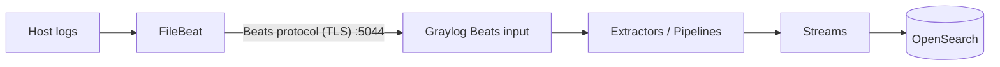

#FileBeat #ELASTIC #GRAYLOG

# FileBeat - Configuration for GrayLog

Graylog receives FileBeat data through a **Beats input**, which speaks the same protocol as LogStash (Lumberjack). So in FileBeat you use `output.logstash`, pointing to the Graylog node. See [[FileBeat - Configuration]] for inputs, parsers and processors, and [[GrayLog]] for Graylog itself.



## 1. Create the Beats input in Graylog

`System → Inputs → Select input: Beats → Launch new input`

| Field                                 | Value                                                     |
| ------------------------------------- | --------------------------------------------------------- |
| Global                                | Enabled to run on every Graylog node (cluster)            |
| Title                                 | `beats-5044`                                              |
| Bind address                          | `0.0.0.0`                                                 |
| Port                                  | `5044`                                                    |
| Enable TLS                            | Yes                                                       |
| TLS cert file / TLS private key file  | Certificate and key of the Graylog node                   |
| TLS client authentication             | `required` if you use mutual TLS (FileBeat presents a cert) |
| TLS Client Auth Trusted Certs         | CA that signed the FileBeat certificates                  |
| Do not add Beats type as prefix       | Enabled → fields are not prefixed with `filebeat_`        |

> [!tip] If **Do not add Beats type as prefix** is disabled, every field arrives with a prefix: `filebeat_service`, `filebeat_host_name`, `filebeat_log_file_path`... Decide it at the beginning, because streams and pipeline rules depend on the field names.

> [!note] Ports below 1024 need root privileges. Keep `5044` or any port above 1024.

## 2. Open the port in the Graylog node (RHEL)

```bash
sudo firewall-cmd --permanent --add-port=5044/tcp
sudo firewall-cmd --reload
```

If there is a load balancer in front of the Graylog cluster, it must balance **TCP** (layer 4), not HTTP.

## 3. Configure FileBeat

`/etc/filebeat/filebeat.yml`:

```yaml
filebeat.inputs:
  - type: filestream
    id: myapp
    paths:
      - /var/log/myapp/*.log
    parsers:
      - multiline:
          type: pattern
          pattern: '^\d{4}-\d{2}-\d{2}'
          negate: true
          match: after
    fields:
      service: myapp
      env: production
    fields_under_root: true

  - type: journald
    id: system-journal

processors:
  - add_host_metadata: ~
  - drop_fields:
      fields: ["agent.ephemeral_id", "ecs.version"]
      ignore_missing: true

output.logstash:
  hosts: ["graylog01.example.com:5044", "graylog02.example.com:5044"]
  loadbalance: true
  ssl.certificate_authorities: ["/etc/filebeat/certs/ca.crt"]
  # Only for mutual TLS:
  ssl.certificate: "/etc/filebeat/certs/filebeat.crt"
  ssl.key: "/etc/filebeat/certs/filebeat.key"
```

> [!warning] Do **not** run `filebeat setup` and do not rely on FileBeat **modules** parsing: modules parse with ElasticSearch ingest pipelines, which Graylog doesn't execute. With Graylog you receive the raw `message` and parse it with Graylog pipelines or extractors.

## 4. Test

```bash
filebeat test config
filebeat test output
sudo systemctl restart filebeat
sudo journalctl -u filebeat -f
```

In Graylog: `System → Inputs → Show received messages` on the Beats input.

## 5. Process the messages in Graylog

Typical setup:

1. **Stream** per application, with a rule on a field sent by FileBeat (e.g. `service` = `myapp`), and *Remove matches from 'Default Stream'* enabled.
2. **Index set** per stream if you need different retention.
3. **Pipeline** connected to the stream to parse the `message`.

Example pipeline rule to parse a JSON message:

```
rule "parse myapp json"
when
  has_field("service") && to_string($message.service) == "myapp"
then
  let json = parse_json(to_string($message.message));
  set_fields(to_map(json));
end
```

Example with a GROK pattern:

```
rule "parse myapp text"
when
  to_string($message.service) == "myapp"
then
  let parsed = grok(pattern: "%{TIMESTAMP_ISO8601:ts} %{LOGLEVEL:level} %{GREEDYDATA:msg}", value: to_string($message.message), only_named_captures: true);
  set_fields(parsed);
end
```

## Troubleshooting

| Problem                                 | Check                                                                                      |
| --------------------------------------- | ------------------------------------------------------------------------------------------ |
| `filebeat test output` fails on TLS     | CA in `ssl.certificate_authorities`, hostname in the certificate SAN must match `hosts`    |
| Connection refused                      | Input running on that node (Global), firewall, bind address                                |
| Messages arrive with `filebeat_` fields | Enable *Do not add Beats type as prefix* in the input                                      |
| Messages not in the expected stream     | Stream rule field name (with or without prefix), stream started                            |
| Stack traces split                      | `multiline` parser in FileBeat (Graylog can't join lines afterwards)                      |
| Input throughput issues                 | Use several Graylog nodes in `hosts` with `loadbalance: true`                              |

## Related notes

- [[FileBeat]]
- [[FileBeat - Configuration]]
- [[FileBeat - Configuration for LogStash]]
- [[GrayLog]]
