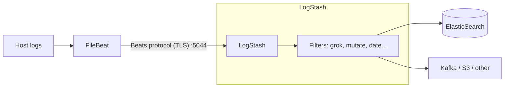

#FileBeat #ELASTIC #LOGSTASH

# FileBeat - Configuration for LogStash

FileBeat sends events to [[LogStash]] with `output.logstash`, using the **Beats (Lumberjack) protocol**. LogStash receives them with the `beats` input plugin, transforms them (grok, mutate, enrich...) and sends them to one or many destinations. See [[FileBeat - Configuration]] for inputs, parsers and processors.



**When to use LogStash between FileBeat and ElasticSearch:**

- Heavy parsing or enrichment (lookups, GeoIP, translate, ruby...).
- Sending the same events to **several destinations** (FileBeat only allows one output).
- Buffering with persistent queues, or centralising the connection to ElasticSearch.

## 1. Configure the LogStash Beats input

`/etc/logstash/conf.d/beats.conf`:

```ruby
input {
  beats {
    port => 5044
    ssl_enabled => true
    ssl_certificate => "/etc/logstash/certs/logstash.crt"
    ssl_key => "/etc/logstash/certs/logstash.pkcs8.key"
    # Mutual TLS (optional):
    # ssl_certificate_authorities => ["/etc/logstash/certs/ca.crt"]
    # ssl_client_authentication => "required"
  }
}

filter {
  if [service] == "myapp" {
    grok {
      match => { "message" => "%{TIMESTAMP_ISO8601:ts} %{LOGLEVEL:level} %{GREEDYDATA:msg}" }
    }
    date {
      match => ["ts", "ISO8601"]
      target => "@timestamp"
    }
    mutate {
      remove_field => ["ts"]
    }
  }
}

output {
  elasticsearch {
    hosts => ["https://es01.example.com:9200"]
    user => "logstash_writer"
    password => "${ES_PWD}"
    ssl_certificate_authorities => ["/etc/logstash/certs/ca.crt"]
    index => "%{[@metadata][beat]}-%{[@metadata][version]}"
    action => "create"
  }
}
```

> [!warning] The Beats input needs the private key in **PKCS#8** format. Convert it with:
> ```bash
> openssl pkcs8 -in logstash.key -topk8 -nocrypt -out logstash.pkcs8.key
> ```

> [!note] The SSL option names changed in LogStash 8.x (`ssl` → `ssl_enabled`, `ssl_verify_mode` → `ssl_client_authentication`...). Check the plugin docs of your version.

`[@metadata][beat]` and `[@metadata][version]` are set by FileBeat (`filebeat`, `9.x.x`), so the index ends up as `filebeat-<version>`, the same name FileBeat would use when sending directly.

Open the port (RHEL):

```bash
sudo firewall-cmd --permanent --add-port=5044/tcp
sudo firewall-cmd --reload
```

Test the pipeline syntax and restart:

```bash
sudo -u logstash /usr/share/logstash/bin/logstash --path.settings /etc/logstash -t
sudo systemctl restart logstash
```

## 2. Configure FileBeat

`/etc/filebeat/filebeat.yml`:

```yaml
filebeat.inputs:
  - type: filestream
    id: myapp
    paths:
      - /var/log/myapp/*.log
    fields:
      service: myapp
    fields_under_root: true

processors:
  - add_host_metadata: ~

output.logstash:
  hosts: ["logstash01.example.com:5044", "logstash02.example.com:5044"]
  loadbalance: true
  ssl.certificate_authorities: ["/etc/filebeat/certs/ca.crt"]
  # Only for mutual TLS:
  # ssl.certificate: "/etc/filebeat/certs/filebeat.crt"
  # ssl.key: "/etc/filebeat/certs/filebeat.key"
```

Useful options of `output.logstash`:

| Option              | Description                                                                  |
| ------------------- | ---------------------------------------------------------------------------- |
| `hosts`             | List of LogStash nodes                                                       |
| `loadbalance`       | `true` = distribute events between all hosts. `false` = use one, failover to others |
| `worker`            | Connections per host                                                         |
| `bulk_max_size`     | Max events per batch                                                         |
| `compression_level` | `0`–`9`, default `3`                                                         |
| `ttl`               | Reconnect after this time so new LogStash nodes behind a LB get traffic     |
| `pipelining`        | Batches sent without waiting for ACK (default `2`)                           |

## 3. Using FileBeat modules through LogStash

Module parsing is done by **[[ElasticSearch - Ingest Pipelines|ElasticSearch ingest pipelines]]**. To keep it working through LogStash:

1. Load the pipelines once, connecting FileBeat temporarily to ElasticSearch:

```bash
sudo filebeat setup --index-management --pipelines --modules nginx,system \
  -E output.logstash.enabled=false \
  -E 'output.elasticsearch.hosts=["https://es01.example.com:9200"]' \
  -E output.elasticsearch.username=filebeat_setup \
  -E 'output.elasticsearch.password=${ES_PWD}'
```

2. In LogStash, send the events to the pipeline indicated by FileBeat in `[@metadata][pipeline]`:

```ruby
output {
  if [@metadata][pipeline] {
    elasticsearch {
      hosts => ["https://es01.example.com:9200"]
      index => "%{[@metadata][beat]}-%{[@metadata][version]}"
      action => "create"
      pipeline => "%{[@metadata][pipeline]}"
      user => "logstash_writer"
      password => "${ES_PWD}"
    }
  } else {
    elasticsearch {
      hosts => ["https://es01.example.com:9200"]
      index => "%{[@metadata][beat]}-%{[@metadata][version]}"
      action => "create"
      user => "logstash_writer"
      password => "${ES_PWD}"
    }
  }
}
```

## 4. Test

```bash
filebeat test config
filebeat test output
sudo systemctl restart filebeat
```

To see what LogStash receives, add a temporary output:

```ruby
output {
  stdout { codec => rubydebug { metadata => true } }
}
```

and follow it with `journalctl -u logstash -f`.

## Troubleshooting

| Problem                                       | Check                                                                         |
| --------------------------------------------- | ----------------------------------------------------------------------------- |
| `filebeat test output` fails on TLS           | CA in FileBeat, hostname in the LogStash certificate SAN                      |
| LogStash: `File does not contain valid private key` | Key not in PKCS#8 format                                                |
| Events stuck / FileBeat slow                  | LogStash filters too slow → backpressure. Check pipeline workers and `pipeline.batch.size` |
| `_grokparsefailure` tag                       | Grok pattern doesn't match; test it in Kibana → Dev Tools → Grok Debugger     |
| Only one LogStash receives traffic            | `loadbalance: true` in FileBeat                                               |
| Module fields not parsed                      | Pipelines not loaded or `pipeline => "%{[@metadata][pipeline]}"` missing      |

## Related notes

- [[FileBeat]]
- [[ElasticSearch]]
- [[ElasticSearch - Ingest Pipelines]]
- [[LogStash]]
- [[LogStash - Pipeline Configuration]]
- [[LogStash - Settings and Queues]]
- [[FileBeat - Configuration]]
- [[FileBeat - Configuration for ElasticSearch]]
- [[FileBeat - Configuration for GrayLog]]
