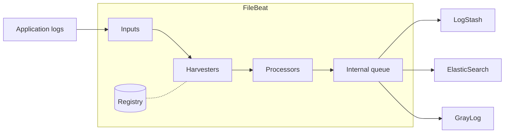

#FileBeat #ELASTIC

# FileBeat

FileBeat is a lightweight log shipper developed by **Elastic**, part of the **Beats** family (Metricbeat, Packetbeat, Auditbeat...).

It runs as an agent on servers, containers or Kubernetes nodes, monitors the configured files or log sources, collects new log events and forwards them to a central destination like:

| Output          | Use cases                                             |
| --------------- | ----------------------------------------------------- |
| `elasticsearch` | Index logs directly in [[ElasticSearch]]              |
| `logstash`      | Send to [[LogStash]] or to the Beats Input of GrayLog[^1] |
| `kafka`         | Independent queue for later processing                |
| `redis`         | Buffer or queue for another consumer                  |
| `file`          | NDJSON files for debugging, testing or later sending  |
| `console`       | JSON in STDOUT for testing or debugging               |
| `discard`       | Don't send anything, only for testing                 |

> [!warning] Only **one output** can be enabled at the same time. If you need to send the same logs to several destinations, send them to LogStash or Kafka and fan out from there.

## How it works



1. **Inputs** define *where* to look for data (file paths, journald, syslog, TCP/UDP...). FileBeat discovers the files that match the configured paths.
2. A **harvester** is started for each file found. It reads the file line by line and sends the new content forward.
3. **Processors** can add metadata, parse fields or drop events before they leave the host.
4. Events are stored in an **internal queue** (memory by default) and sent in batches by the **output**.
5. The **registry** stores the last position read in each file. If FileBeat restarts, it continues from where it stopped instead of reading everything again.

## Key concepts

| Concept        | Description                                                                                                         |
| -------------- | ------------------------------------------------------------------------------------------------------------------- |
| **Input**      | Source of data. The recommended input for files is `filestream`. The old `log` input is deprecated.                 |
| **Harvester**  | Reader for a single file. Keeps the file open while there is new data.                                             |
| **Registry**   | State file with the offset of every file. Lives in `/var/lib/filebeat/registry/` on Linux packages.                |
| **Module**     | Predefined configuration for common services (nginx, apache, system, mysql...). Includes inputs, parsing and dashboards. |
| **Processor**  | Transformation applied to each event inside FileBeat (`add_fields`, `drop_event`, `dissect`...).                   |
| **Parser**     | Transformation applied while reading the file (`multiline`, `ndjson`, `container`).                                |
| **Backpressure** | If the output is slow or down, FileBeat stops reading instead of losing data.                                    |

## Main features

- It is designed to be lightweight and suitable for deployment on many hosts, VMs, Docker containers and Kubernetes clusters.
- It can collect plain-text logs, JSON logs, container logs and logs from common services through predefined **modules**.
- It supports **processors** to add metadata, parse fields, drop events or enrich logs before sending them.
- It can send data directly to ElasticSearch or through LogStash for additional transformation and enrichment.
- It provides **at-least-once delivery**: it persists the reading state of each file in the registry and retries until the output acknowledges the events. This means that in some failure cases an event can be **duplicated**, but not lost.

## When to use FileBeat

| Use FileBeat                                   | Consider something else                                             |
| ---------------------------------------------- | ------------------------------------------------------------------- |
| Shipping log files from many hosts             | Heavy parsing / enrichment → do it in LogStash or Graylog pipelines |
| Low resource usage on the host                 | Metrics → Metricbeat                                                |
| Simple processing (add fields, drop, JSON)     | Centralised agent management → Elastic Agent + Fleet                |

## Basic commands

```bash
# Run in foreground printing its own logs to stderr (useful for debugging)
filebeat -e -c /etc/filebeat/filebeat.yml

# Check the syntax of the configuration
filebeat test config

# Check the connection with the configured output
filebeat test output

# List / enable / disable modules
filebeat modules list
filebeat modules enable system nginx
filebeat modules disable nginx

# Load index templates, ILM and Kibana dashboards (Elastic stack only)
filebeat setup -e

# Show the final configuration after merging all files
filebeat export config
```

As a service (RPM / DEB packages):

```bash
sudo systemctl enable --now filebeat
sudo systemctl status filebeat
sudo journalctl -u filebeat -f
```

## Installation

### RHEL / Rocky / Alma (RPM)

Import the Elastic GPG key and add the repository (replace `9.x` with the major version you need):

```bash
sudo rpm --import https://artifacts.elastic.co/GPG-KEY-elasticsearch

sudo tee /etc/yum.repos.d/elastic.repo <<'REPO'
[elastic-9.x]
name=Elastic repository for 9.x packages
baseurl=https://artifacts.elastic.co/packages/9.x/yum
gpgcheck=1
gpgkey=https://artifacts.elastic.co/GPG-KEY-elasticsearch
enabled=1
autorefresh=1
type=rpm-md
REPO

sudo dnf install filebeat
```

### Debian / Ubuntu

```bash
wget -qO - https://artifacts.elastic.co/GPG-KEY-elasticsearch | sudo gpg --dearmor -o /usr/share/keyrings/elastic.gpg
echo "deb [signed-by=/usr/share/keyrings/elastic.gpg] https://artifacts.elastic.co/packages/9.x/apt stable main" | sudo tee /etc/apt/sources.list.d/elastic-9.x.list
sudo apt update && sudo apt install filebeat
```

### Docker

```bash
docker run -d --name filebeat --user root \
  -v $(pwd)/filebeat.yml:/usr/share/filebeat/filebeat.yml:ro \
  -v /var/log:/var/log:ro \
  -v /var/lib/docker/containers:/var/lib/docker/containers:ro \
  docker.elastic.co/beats/filebeat:<version> -e --strict.perms=false
```

> [!tip] Keep the FileBeat version aligned with the major version of ElasticSearch / LogStash. For Graylog check the supported Beats versions in the Graylog documentation.

### File locations (RPM / DEB)

| Path                          | Content                               |
| ----------------------------- | ------------------------------------- |
| `/etc/filebeat/filebeat.yml`  | Main configuration file               |
| `/etc/filebeat/modules.d/`    | Module configuration files            |
| `/usr/share/filebeat/`        | Binaries, modules and kibana assets   |
| `/var/lib/filebeat/`          | Data folder: **registry**             |
| `/var/log/filebeat/`          | FileBeat own logs                     |

## Related notes

- [[FileBeat - Configuration]]
- [[FileBeat - Configuration for ElasticSearch]]
- [[FileBeat - Configuration for LogStash]]
- [[FileBeat - Configuration for GrayLog]]
- [[GrayLog]]
- [[ElasticSearch]]
- [[LogStash]]

[^1]: GrayLog [[GrayLog]]
