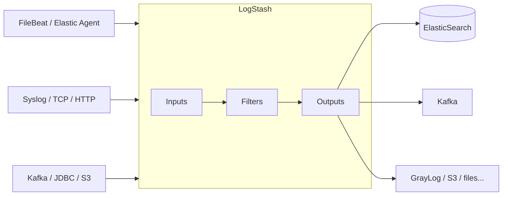
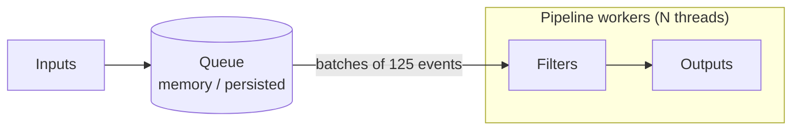

#ELASTIC #LOGSTASH

# LogStash

LogStash is a server-side **data processing pipeline** developed by **Elastic**. It receives data from many sources at the same time, **transforms** it (parse, enrich, filter) and sends it to one or several destinations. It runs on the **JVM** and is extended with **plugins** (more than 200 inputs, filters, outputs and codecs).

Inside the Elastic Stack it sits between the shippers and [[ElasticSearch]]:



## How it works

Every LogStash **pipeline** has three stages:

| Stage        | Description                                                                                    | Examples                                          |
| ------------ | ---------------------------------------------------------------------------------------------- | ------------------------------------------------- |
| **Inputs**   | Receive or read data and create **events**                                                    | `beats`, `tcp`, `syslog`, `kafka`, `file`, `jdbc` |
| **Filters**  | Transform each event (optional)                                                                | `grok`, `dissect`, `mutate`, `date`, `geoip`      |
| **Outputs**  | Send the event to its destination                                                              | `elasticsearch`, `kafka`, `s3`, `stdout`          |

**Codecs** (`json`, `json_lines`, `plain`, `multiline`...) are used inside inputs and outputs to decode / encode the data stream.



1. **Inputs** run in their own threads and put events in the **queue** (in memory by default, or on disk with the *persistent queue*).
2. **Pipeline workers** (one per CPU core by default) take **batches** of events from the queue and run the filters and outputs on them.
3. When an output is slow or down, the queue fills and the inputs stop accepting data (**backpressure**). FileBeat then stops reading instead of losing logs.

## Key concepts

| Concept              | Description                                                                                          |
| -------------------- | ---------------------------------------------------------------------------------------------------- |
| **Event**            | Unit of data, a JSON-like document with fields. `@timestamp` and `message` are created by most inputs |
| **Pipeline**         | One `input → filter → output` flow. A LogStash instance can run **several pipelines** (`pipelines.yml`) |
| **Plugin**           | Input, filter, output or codec. Installed with `logstash-plugin`                                      |
| **Field reference**  | `[field][subfield]` to read fields in conditionals and filters                                        |
| **`@metadata`**      | Special field to store temporary values. It is **never sent** by the outputs                          |
| **Persistent queue** | Queue on disk. Survives restarts and gives *at-least-once* delivery                                   |
| **Dead letter queue (DLQ)** | Stores events rejected by ElasticSearch (e.g. mapping errors) to reprocess them later         |
| **ECS compatibility** | Plugins create fields following the Elastic Common Schema (`source.ip`, `log.level`...). Default `v8` |

## When to use LogStash

| Use LogStash                                                       | Consider something else                                                     |
| ------------------------------------------------------------------ | --------------------------------------------------------------------------- |
| Several destinations for the same data (FileBeat has only 1 output) | Only ElasticSearch and simple parsing → [[ElasticSearch - Ingest Pipelines]] |
| Heavy parsing / enrichment (lookups, translate, ruby, aggregate)   | Lightweight work on the host → [[FileBeat]] processors                      |
| Sources that Beats doesn't cover (JDBC, S3, HTTP, Kafka...)        | Log management with UI-defined parsing → GrayLog pipelines                  |
| Buffering with disk queues, centralise access to ElasticSearch    | Very low resources available (LogStash needs ≥ 1–2 GB of heap)              |

## Installation

### RHEL / Rocky / Alma (RPM)

Use the same Elastic repository described in [[FileBeat]] (`/etc/yum.repos.d/elastic.repo`):

```bash
sudo dnf install logstash
sudo systemctl enable --now logstash
```

The package includes its own **bundled JDK**, no Java installation is needed.

### Debian / Ubuntu

With the Elastic APT repository configured (see [[FileBeat]]):

```bash
sudo apt update && sudo apt install logstash
```

### Docker

```bash
docker run -d --name logstash -p 5044:5044 -p 9600:9600 \
  -v $(pwd)/pipeline/:/usr/share/logstash/pipeline/:ro \
  -v $(pwd)/logstash.yml:/usr/share/logstash/config/logstash.yml:ro \
  docker.elastic.co/logstash/logstash:<version>
```

In the image, every `.conf` file in `/usr/share/logstash/pipeline/` is loaded as the `main` pipeline.

> [!tip] Keep the LogStash version aligned with ElasticSearch (same major version, LogStash ≤ ElasticSearch).

### File locations (RPM / DEB)

| Path                              | Content                                                   |
| --------------------------------- | --------------------------------------------------------- |
| `/etc/logstash/logstash.yml`      | Settings of the LogStash instance                         |
| `/etc/logstash/pipelines.yml`     | List of pipelines and their config files                  |
| `/etc/logstash/conf.d/*.conf`     | Pipeline definitions (input / filter / output)            |
| `/etc/logstash/jvm.options`       | JVM options (heap)                                        |
| `/etc/logstash/log4j2.properties` | LogStash own logging                                      |
| `/usr/share/logstash/bin/`        | `logstash`, `logstash-plugin`, `logstash-keystore`        |
| `/var/lib/logstash/`              | Data: persistent queues, DLQ, plugin state (`sincedb`)    |
| `/var/log/logstash/`              | LogStash own logs (`logstash-plain.log`)                  |

## Basic commands

```bash
# Test the configuration and exit (always before restarting)
sudo -u logstash /usr/share/logstash/bin/logstash --path.settings /etc/logstash -t

# Quick test with an inline pipeline: type lines and see the events
/usr/share/logstash/bin/logstash -e 'input { stdin {} } output { stdout { codec => rubydebug } }'

# Run a pipeline file in the foreground reloading it when it changes
/usr/share/logstash/bin/logstash -f test.conf --config.reload.automatic

# Plugins
/usr/share/logstash/bin/logstash-plugin list --verbose
/usr/share/logstash/bin/logstash-plugin install logstash-output-gelf
/usr/share/logstash/bin/logstash-plugin update

# Service
sudo systemctl restart logstash
sudo journalctl -u logstash -f
sudo tail -f /var/log/logstash/logstash-plain.log
```

> [!warning] Since LogStash 9.x running as **root** is blocked by default (`allow_superuser: false`). Run it as the `logstash` user (the service already does it) and give that user permissions on the files it needs to read.

## Monitoring API

LogStash exposes an API on port `9600` (only `localhost` by default):

```bash
curl -s localhost:9600/?pretty                          # Version and status
curl -s localhost:9600/_node/pipelines?pretty           # Loaded pipelines
curl -s localhost:9600/_node/stats/pipelines?pretty     # Events in/out, time per plugin, queue
curl -s localhost:9600/_node/hot_threads?pretty         # What is consuming CPU
curl -s localhost:9600/_health_report?pretty            # Health of each pipeline
```

In the stats, compare `events.in` and `events.out` and the `duration_in_millis` of each filter to find the slow one.

## Related notes

- [[LogStash - Pipeline Configuration]]
- [[LogStash - Settings and Queues]]
- [[FileBeat - Configuration for LogStash]]
- [[ElasticSearch]]
- [[ElasticSearch - Ingest Pipelines]]
- [[FileBeat]]
- [[GrayLog]]
